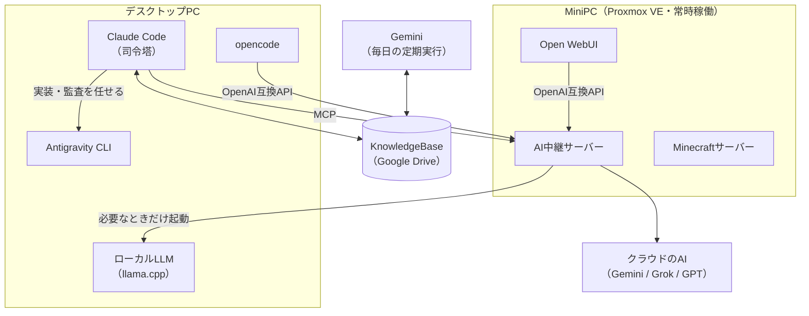

# fraislua

ゲームプランナー / ゲームプログラマー志望の大学3回生です。Unity (C#) で個人・チームのゲーム制作を続けながら、AIエージェントを開発に組み込む方法を自宅の環境で試し、記録しています。

## 1. 基本情報

- 所属: 大学3回生
- 志望職種: ゲームプランナー / ゲームプログラマー

## 2. 設計哲学（Philosophy）

- 手触り（Juice）と即時フィードバックの数値・論理的設計
- 完成50% / 見せ方50%（バーティカルスライス）

（詳細は下記「思考ログ一覧」の各記事を参照）

## 3. 作品

### 公開中（ブラウザで遊べます）

| 作品 | 内容 | 形態 | リンク |
|---|---|---|---|
| **EclipseDiver** | 2026年春のUnityroom Game Jamで制作。とにかく短いゲームループと、見ていても飽きない見せ方を重視した | 個人 | [unityroom](https://unityroom.com/games/eclipsediver) |
| **Bang's-Edge** | 長押しで粒子を集め、ビッグバンが起きる寸前で離してスコアを競うミニゲーム。AIにどこまで作業を分散させられるかを試したプロジェクトでもある | 個人 | [unityroom](https://unityroom.com/games/bang-s-edge) / [GitHub](https://github.com/fraislua/Bang-s-Edge) |
| **Formation: Linea** | 点・線・図形で戦うストラテジーゲーム。引いた線の通りに味方を動かし、味方の位置を頂点にした図形の範囲に大ダメージを与える | 大学のチーム制作（ゲーム内容の一部のプランナー） | [unityroom](https://unityroom.com/games/formation_linea) |
| **PRPG** | ピンボールで得点を稼いで敵を倒す「ピンボール×RPG」 | 大学のチーム制作（ピンボール部分の実装） | [unityroom](https://unityroom.com/games/prpg) |
| **super-chess-roguelike** | 駒がスキルを習得して強くなっていく、チェスをベースにした対戦ゲーム（対人戦・CPU戦） | 個人 | [遊ぶ](https://fraislua.github.io/super-chess-roguelike/) / [GitHub](https://github.com/fraislua/super-chess-roguelike) |

### 制作中

- **チーム制作中のVRシューティング**（Meta Quest、学園祭で出展予定）: 敵システムを担当し、4種類の敵の挙動と出現（スポーン）の仕組みを実装した
- **Project_Orbital**（個人）: リアルタイムの宇宙タワーディフェンス。「時間は通貨」「ダイスは事前に見せる」「決定はプレイヤー、状況は確率」の3原則を軸に設計している

## 4. 自宅のAI開発環境

ゲーム制作にAIエージェントを組み込むために、自宅のPCとMiniPCで環境を作り、運用しています。

- **AI中継サーバー**（[discord-local-ai-hub](https://github.com/fraislua/discord-local-ai-hub)）: ローカルLLMとクラウドのAIを、1つの窓口から使えるようにする中継サーバー（自作のハブと、ゲートウェイの Bifrost）。Claude Code からは MCP、Open WebUI と opencode からは OpenAI 互換の API で呼び出す。ローカルのモデルを頼まれたとき、デスクトップPCが止まっていれば Wake-on-LAN で起こす。もとは Discord Bot として作り始めたもの
- **AIエージェントの分担**（非公開）: Claude Code を司令塔にして、実装や監査を Antigravity CLI やローカルのモデルに任せるための設定一式。任せた結果は、テストと差分で確かめてから取り込む
- **自宅サーバー（MiniPC）**: Proxmox VE で用途ごとにコンテナを分けて常時稼働させている。中継サーバーのほか、Minecraftサーバー（Java版・統合版の両対応）、Open WebUI、ホームオートメーション、Google Drive への暗号化バックアップを運用し、外からは Tailscale でつなぐ。構築・運用の記録は約90件（非公開）
- **KnowledgeBase**（個人ナレッジベース）: Google Drive 上のナレッジベースを、Gemini・Claude・Claude Code で共有している。以前は Gemini アプリのエージェント機能「Gemini Spark」（現在の Task）だけで運用していた。Gemini の定期実行が毎日の情報収集と通知を、Claude が設計の修正と結果の検証を担う。推測を事実として残さないことを最優先にして、2026年11月に作り直した。詳細は [knowledge_base.md](./docs/projects/knowledge_base.md)

## 5. 技術スタック

### Game

- Unity (C#)
- DOTween
- UniTask
- UniRx

### Infra

- Proxmox VE
- Ubuntu Server
- PaperMC
- Tailscale

### AI開発ツール

- Claude Code（CLI）
- Antigravity（CLI）
- opencode

### ローカルLLM

- LM Studio

### 使用経験あり（大学の講義・チーム制作）

- Python
- Java
- Meta XR SDK

## 6. 思考ログ一覧

### おすすめ

- [ゲームの手触り：即時フィードバックと遅延フィードバックの心理学](./docs/thinking/01_game_juice_feedback.md)
- [バーティカルスライスとチーム開発の同期ロス対策](./docs/thinking/03_vertical_slice_team_dev.md)
- [AIに任せた監査が5時間枠の140%を使った理由を、ログで確かめる](./docs/thinking/08_audit_token_overrun_log_analysis.md)

### 最新

- [Google AI Proに付いてきたColabのクレジットで、大きめのオープンモデルを動かす](./docs/thinking/09_colab_credit_open_model_trial.md)

すべての記事（9本）

#### ゲームデザイン・チーム開発

- [ゲームの手触り：即時フィードバックと遅延フィードバックの心理学](./docs/thinking/01_game_juice_feedback.md)
- [身体性コントローラーと手応えの設計論（EC2026所感）](./docs/thinking/02_ec2026_physical_controller.md)
- [バーティカルスライスとチーム開発の同期ロス対策](./docs/thinking/03_vertical_slice_team_dev.md)

#### AIツールのコストと検証

- [Claude Codeの実測トークン量から見るコストパフォーマンス](./docs/thinking/04_claude_code_token_cost_analysis.md)
- [Antigravityの5時間枠1回分をAPI価格に換算する](./docs/thinking/05_antigravity_quota_cost_analysis.md)
- [AIサブスクリプションの利用枠をAPI価格で並べる（まとめ）](./docs/thinking/06_ai_subscription_quota_summary.md)
- [AIに調べさせた「他社の実測値」を一次情報で確かめる](./docs/thinking/07_ai_research_verification_and_harness.md)
- [AIに任せた監査が5時間枠の140%を使った理由を、ログで確かめる](./docs/thinking/08_audit_token_overrun_log_analysis.md)
- [Google AI Proに付いてきたColabのクレジットで、大きめのオープンモデルを動かす](./docs/thinking/09_colab_credit_open_model_trial.md)

## 7. 連絡先・リンク

- Email: fraislua@gmail.com
- Steam: https://steamcommunity.com/profiles/76561199172911128/
- unityroom: https://unityroom.com/users/luqisb2z0rx6jdc4okyt

---

最終更新日: 2026-11-06
